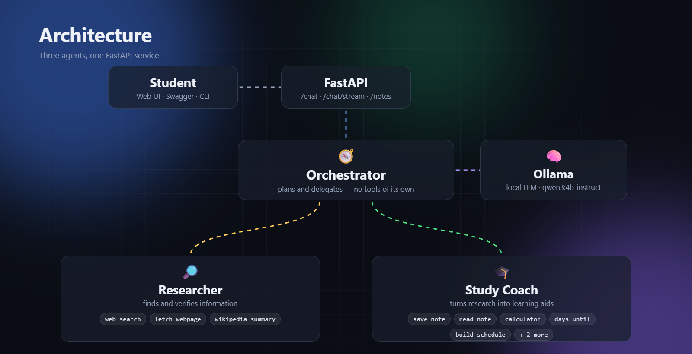

# StudyMate: A Multi-Agent Study and Research Assistant

Members: Yathindu Jayawardena (200428502134, C clarke 499) and Pamoda Jayathilaka (C clarke 655)

## 1. Problem and Scenario

Students preparing for an exam repeat the same workflow by hand: look up a concept, check that the source is trustworthy, condense it into notes, test themselves, and work out how many days remain and how to spread the topics over them. These steps are usually split across a search engine, a notes app, a calculator and a calendar.

StudyMate automates this as a variation of the "Study buddy / tutor" scenario. A student asks in plain language, for example "Research how attention works in transformers, save a note, and quiz me", and the agents find sources, save notes, write a quiz, or build a timetable up to an exam date. It suits an agent system because the work has distinct roles (finding information, building study material) and real dependencies: the quiz needs the research first, and the timetable needs the day count first.

## 2. Model and Architecture

**Model.** The agents run **`qwen3:4b-instruct`** through Ollama, entirely on the laptop: 4.0 billion parameters, Q4_K_M quantisation, 2.5 GB. We chose it because it supports tool calling, it is small enough for a 4 GB GPU (our machine: RTX 2050, 14 GB RAM; about 66% of the model runs on the GPU and the rest on the CPU), and it is a non-thinking model, so calls take seconds. We first tried the default `qwen3:4b` tag, which turned out to be a thinking-only build (see Section 8).

Data flow: the student's message reaches the **FastAPI** service (`api.py`) or the CLI; the Orchestrator decides which specialist to call; each agent loop sends its messages and tool declarations to Ollama, runs the tools the model requests, and feeds the results back; a tracer records every step and streams it to the browser as Server-Sent Events (`POST /chat/stream`), so the chat page shows the trace building live. `POST /chat` returns the same trace as JSON, and Swagger UI is at `/docs`. Histories are kept per session. We wrote the loop ourselves, without a framework, so every decision and tool call is visible.

The code is split into small modules. `agent.py` holds the generic `Agent` and its loop, `llm.py` is the only file that talks to Ollama, `agents.py` holds the prompts and delegation, `tools/` holds the tools, and `trace.py` records everything.

## 3. Agents

**Orchestrator.** The only agent the student talks to. Its two "tools" are `ask_researcher` and `ask_study_coach`, each of which runs another agent's complete loop. It decomposes a request, picks the order, and passes one specialist's output into the next. It answers greetings and follow-ups about earlier results directly.

**Researcher.** Gathers information with web search, page reading and Wikipedia, and must cite only what its tools returned.

**Study Coach.** Builds notes, quizzes and timetables, and does arithmetic and date work. It has no internet access by design, so it cannot replace research with unverified knowledge.

Each agent sees only three to seven tools, which reduces wrong-tool choices. Sub-agents are stateless: every delegation starts with a fresh history.

## 4. Tools

| Tool (agent) | Purpose and parameters | Sample output |
|---|---|---|
| `web_search` (Researcher) | DuckDuckGo search: `query`, `max_results` (1 to 8) | `1. Gradient descent - Wikipedia https://en.wikipedia.org/wiki/Gradient_descent Illustration of...` |
| `fetch_webpage` (Researcher) | Readable text of a public page: `url` | `Title: Gradient descent - Wikipedia URL: https://... Gradient descent is...` |
| `wikipedia_summary` (Researcher) | Lead summary of an article: `topic` | `Gradient descent: Gradient descent is a method for unconstrained mathematical optimization...` |
| `save_note`, `read_note`, `list_notes` (Coach) | Persistent markdown notes in `notes/`: `title`, `content` | `Saved note 'Attention' (872 characters) to attention.md.` |
| `calculator` (Coach) | Arithmetic: `expression` | `1234 * 5678 = 7006652` |
| `get_current_date`, `days_until` (Coach) | Date facts: none, or `target_date` (ISO) | `Friday, 2026-10-23` / `28 days until 2026-11-20` |
| `build_schedule` (Coach) | Timetable: `topics[]`, `start_date`, `end_date`, `hours_per_day` | `Fri 2026-10-23 (2h): backpropagation ...` |
| `ask_researcher`, `ask_study_coach` (Orchestrator) | Run a specialist: `task` | the specialist's reply |

Every tool validates its input and returns a clear error instead of crashing. `calculator` parses with Python's `ast` module and never calls `eval`. `fetch_webpage` accepts only public `http(s)` hosts, so the agent cannot be steered to `localhost`. Note titles are reduced to a slug, so `../../etc/passwd` cannot escape the notes folder. Date arithmetic is a tool because models are unreliable at it. Tool output is truncated to 2,500 characters for the small context window.

## 5. The Agent Loop

All three agents use the same loop, `Agent.run`:

1. Append the user's task to the history.
2. Send the system prompt, history and tool declarations to the model.
3. Append the model's reply to the history.
4. If the reply has no tool calls, it is the final answer.
5. Otherwise run each requested tool, trace the call and result, append the results, and go to step 2.
6. After `MAX_STEPS` (8) iterations, stop and report that the limit was reached.

Delegation falls out naturally: calling `ask_researcher` runs the Researcher's own loop (depth 1) and returns its final text. The trace is indented by depth.

Small models fail in ways prompts alone cannot fix, so the loop has code-level protections:

- **Grounding guard.** An agent can be required to call a tool before its first answer. If it answers from memory, the loop sends one reminder (restating the task) and lets it try again. The Researcher always has this guard; the Coach has it only for tasks involving arithmetic, dates or notes, so ordinary writing costs no extra call.
- **Tool filtering.** Each task is offered only the tools it needs: the Coach gets the note tools only if its task mentions notes, the date tools only for date work, the calculator only for arithmetic. A tool that is not offered cannot be called.
- **Context budget.** Before each call the oldest long tool outputs are shortened until the prompt fits the context window, because Ollama otherwise drops the start of the prompt silently. Replies are capped at 1,200 tokens and calls time out after 180 s.
- **Errors.** Tool errors go back to the model so it can recover. A model failure (Ollama stopped, model not pulled, timeout) raises an `LLMError` that stops the whole run with an actionable message.
- **Presentation by code.** The Orchestrator only routes. The answer the student sees is assembled from the specialists' own replies, with LaTeX converted to plain text, so nothing can be dropped or invented while copying.

## 6. Prompt Design and Memory

Each system prompt gives a role, the tool list, and numbered rules. The Orchestrator prompt is a routing table: explain, research or cite means `ask_researcher` first, never from memory; notes, quizzes, timetables and calculations mean `ask_study_coach`; multi-step requests are done in order, passing each result forward; copy the student's numbers exactly; reply "Done" when the specialists finish. The Researcher may use only tool results and at most three calls. The Coach must use tools for arithmetic, dates and notes, and only the tools the task needs. The Orchestrator prompt ends with the real current date, and delegated tasks also carry the student's exact words so numbers cannot drift in paraphrase.

**Memory.** Conversation history is kept for each session (browser) or CLI run, so follow-ups work. In a live test, "What is 1234 * 5678?" was followed by "Now divide that result by 2." (answered 3,503,326 using the earlier result) and "What was the very first number I asked you to multiply?" (answered 1234).

## 7. Testing

**Automated tests.** 53 pytest tests run offline with a scripted fake model (`tests/test_core.py`, `tests/test_tools.py`). They cover the loop (tool execution, errors, bad arguments, step cap, truncation, the grounding guard and its single reminder), the Ollama wrapper (message format, tool-call parsing, context fitting, output cap, unreachable server, missing model, timeout), the FastAPI layer and live event stream, each tool including unsafe input (`__import__('os')`, `localhost`, path traversal), delegation, presentation by code, and the LaTeX cleaner.

**Live tests** on the real local model (times vary between runs):

| Prompt | Tool calls observed | Result |
|---|---|---|
| 1. Explain gradient descent, two sources | `ask_researcher` with `wikipedia_summary`, `web_search` (sometimes `fetch_webpage`) | Grounded answer with real URLs, 31 to 51 s |
| 2. Research attention, save a note, 5-question quiz (multi-step) | `ask_researcher` with 3 research tools, then `ask_study_coach` with `save_note` | Note saved, quiz and answer key shown, 77 to 89 s |
| 3. Exam on 2026-11-20, five topics, 2 h a day | `ask_study_coach` with `get_current_date`, `days_until`, `build_schedule`, `save_note` | Correct 28 days, full timetable and saved note, 107 to 118 s |

## 8. Challenges: What Failed and How We Fixed It

- **The default model was thinking-only.** `qwen3:4b` always reasons first and ignored `think=False`: one "say hello" request returned 2,644 tokens of rambling and took 212 s. Its 262k context also pushed 45% of it onto the CPU. We switched to `qwen3:4b-instruct`, where calls take 1 to 5 s.
- **Answering from memory.** The Orchestrator skipped delegation and the Researcher cited invented sources and URLs. Numbered routing rules helped, but the reliable fix was the grounding guard.
- **Context overflow.** One run hung for 5 minutes: the history reached 3,440 tokens in a 4,096-token window, Ollama silently truncated it, and the model looped. We added the context budget, the 1,200-token reply cap, the timeout, and an error message that says "timed out" rather than "cannot reach Ollama".
- **Dropped or invented content.** The Orchestrator's rewrite omitted a timetable and stated "38 days" when the tool had returned 28, and it wrote LaTeX the chat page cannot render. Assembling the answer in code from the specialists' replies, plus a LaTeX cleaner, removed this class of error (and made runs faster, since the model no longer re-types long output).
- **Wrong arithmetic.** The model multiplied in its head (7,034,352 instead of 7,006,652) and changed "divide by 2" into "divide by -2" while delegating. We added the Coach guard for arithmetic, appended the student's exact words to every delegated task, and told the Orchestrator to copy numbers exactly. Two consecutive live follow-up runs were then correct. This remains the weakest area.
- **Unrequested tool calls and a lost note.** Shown every tool, the Coach built a schedule while saving a note, read notes instead of saving, and in one run saved a quiz under the same title as the note, silently overwriting it. A prompt rule was not enough, so each task is now offered only the tools it needs, which also shortens the prompt.
- **From prototype to Ollama.** We first prototyped on a cloud API and moved to Ollama because the assignment requires a local model. That prototype showed that models invent today's date, so every prompt now states the real date.

## 9. Limitations and Future Improvements

A 4B model on a laptop is slower than a cloud model (1 to 3 minutes for multi-step requests) and is stochastic, so a run can still take a wrong path; we saw this again after most fixes and only manual checks of a few prompts were done, not a formal evaluation. Search depends on DuckDuckGo, sessions live in memory, notes are plain files, and sub-agents have no memory between delegations. Future work: a larger model or GPU, retrieval over the student's own lecture notes, parallel delegations, a verification pass that checks claims against fetched sources, and persistent storage.

## 10. Individual Contributions

| Member | Responsibilities | Files |
|---|---|---|
| Yathindu Jayawardena | Agent loop and grounding guard; Ollama wrapper (message format, context fitting, reply cap, error handling); tracer; configuration; FastAPI service with live streaming and Swagger; CLI; tests for the loop, wrapper, API; report Sections 2, 5, 7 | `agent.py`, `llm.py`, `trace.py`, `config.py`, `api.py`, `main.py`, `tests/test_core.py` |
| Pamoda Jayathilaka | Research and study tools with their safety checks; LaTeX cleaner; agent prompts, routing and presentation logic; web chat page with live trace, markdown and notes panel; tests for tools and delegation; report Sections 3, 4, 6, 8 | `tools/`, `agents.py`, `static/index.html`, `tests/test_tools.py` |
| Both | Problem definition, README, limitations, demo video | `README.md`, `docs/` |

## Appendix: Use of AI Assistants

We used an AI coding assistant, Claude Code , throughout the project. It helped to:

- **Build the system.** It helped in checking our writing and debuging most of the code (agent loop, Ollama wrapper, tools, FastAPI service, web page) and the automated tests, and helped design the prompts and the safeguards described in Sections 5 and 8.
- **Move to Ollama** from our first cloud-model prototype, and diagnose the problems found in live testing.
- **Write the documentation:** the README, this report and the architecture figure.
- **Produce the demo video:** the slides, the narration script, a script that drove the app while recording, and the editing steps (captions and speed-ups). The narration voice is synthetic (Microsoft neural text-to-speech through the `edge-tts` library).

